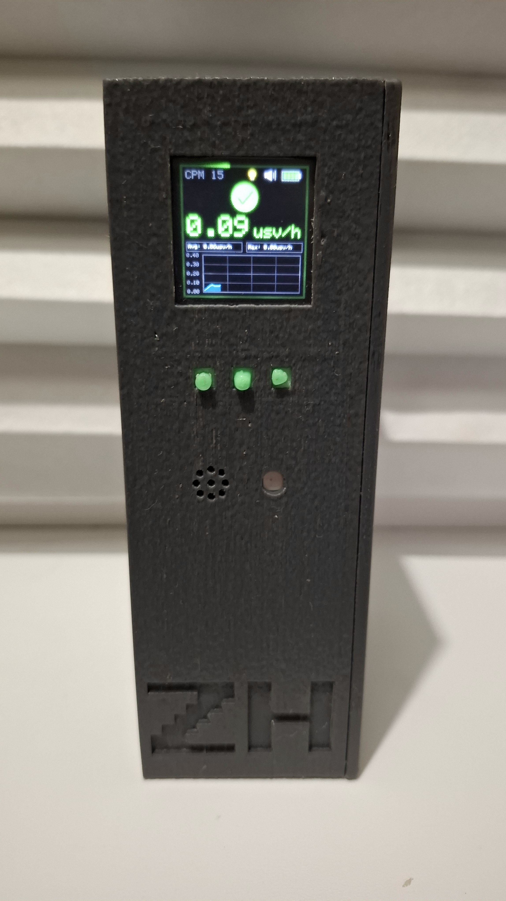
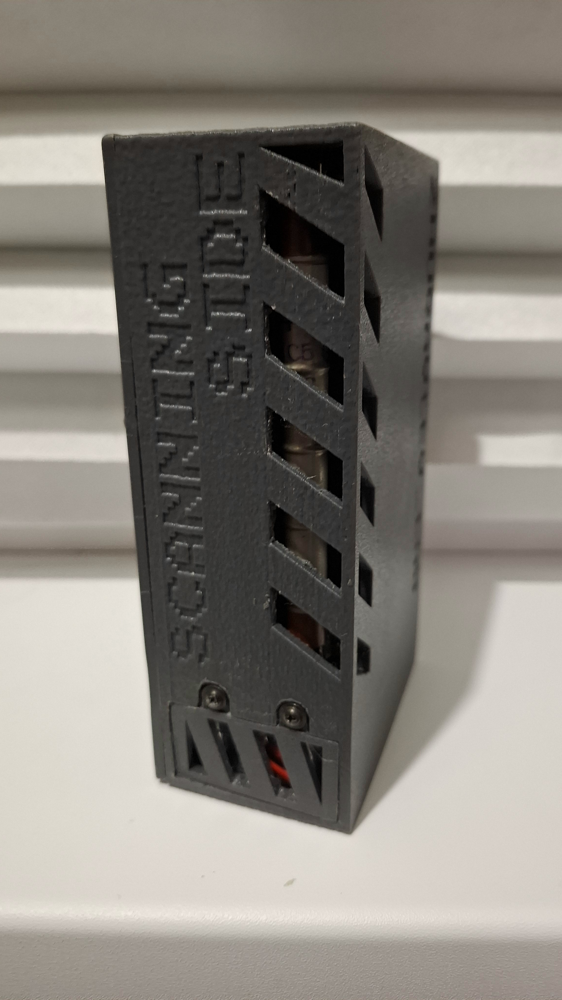
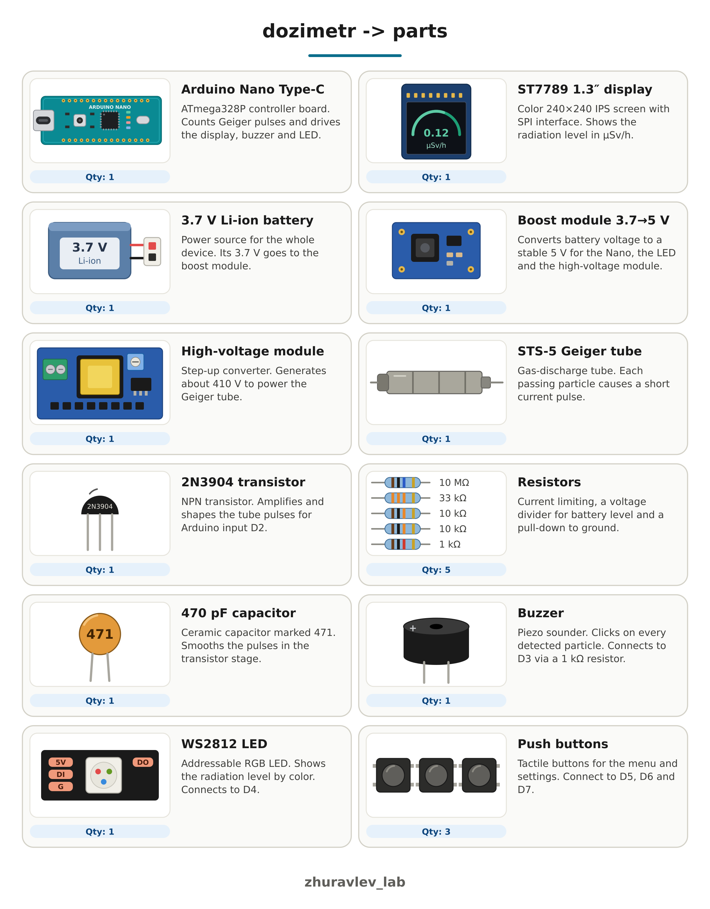
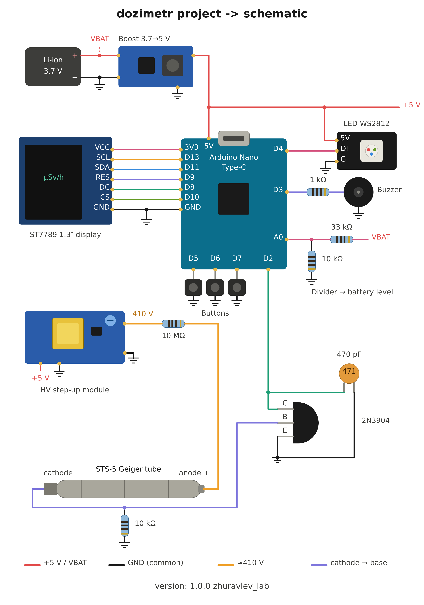
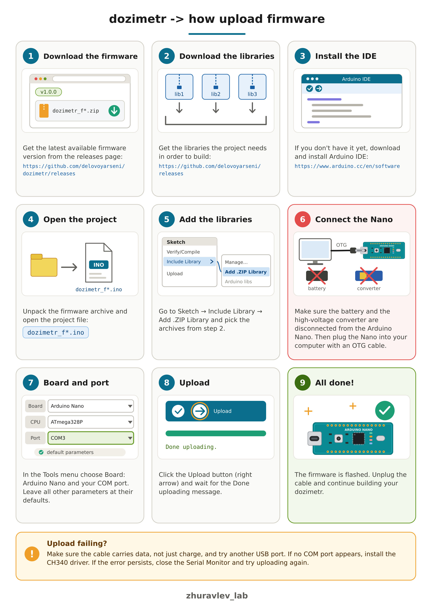

**English** | [Русский](README_ru.md)

# ☢️ dozimetr

**Build your own Dozimetr with Arduino Nano and an STS-5 tube**

[About](#-about) · [Renders](#-renders) · [Parts](#-parts) · [Assembly](#-assembly) · [Flashing](#-connect-and-flash) · [License](#-license)

---

## 📖 About

**dozimetr** is an open-source radiation detector that you can build at home. A Soviet **STS-5** Geiger-Müller tube senses particles, an **Arduino Nano** counts them, and a color display shows the background level in **µSv/h**.

The firmware, wiring schematic, parts list and build guide are all published here. Build it as is, change it, or use it as a base for your own device 🛠️

**Features**

- 📟 Color IPS display (ST7789 1.3″) with the live level in µSv/h
- 🔊 Buzzer click on every detected particle, like a classic Geiger counter
- 🌈 RGB LED (WS2812) that shows the level by color
- 🎛️ Three buttons for the menu and settings
- 🔋 Battery level measurement through a voltage divider
- ⚡ One Li-ion cell (3.7 V), boosted to 5 V for the electronics and to about 410 V for the tube
- 💸 Cheap, common parts and no custom PCB

---

## 🖼️ Renders

The finished device after flashing:

  
  

---

## 🧰 Parts

  

| Part | Qty | Role |
|---|:---:|---|
| 🧠 Arduino Nano Type-C | 1 | ATmega328P controller board |
| 📟 ST7789 1.3″ display | 1 | Color 240×240 IPS screen, SPI |
| 🔋 3.7 V Li-ion battery | 1 | Power source |
| ⬆️ Boost module 3.7→5 V | 1 | Stable 5 V for the electronics |
| ⚡ High-voltage module | 1 | About 410 V for the tube |
| ☢️ STS-5 Geiger tube | 1 | Radiation sensor |
| 🔌 2N3904 transistor | 1 | Shapes the tube pulses |
| 🟦 Resistors: 10 MΩ, 33 kΩ, 1 kΩ, 2 × 10 kΩ | 5 | Current limit, divider, pull-down |
| 🟠 470 pF capacitor (marked 471) | 1 | Smooths pulses in the transistor stage |
| 🔊 Buzzer | 1 | Click on every particle |
| 🌈 WS2812 LED | 1 | Color indication |
| 🔘 Push buttons | 3 | Menu and settings |

🧰 You will also need a soldering iron, wire and a USB data cable (an OTG cable works) for flashing.

---

## 🔧 Assembly

  

**Pin map**

| Arduino pin | Connected to |
|---|---|
| `D2` | Pulse output of the Geiger stage (2N3904 collector) |
| `D3` | Buzzer, through a 1 kΩ resistor |
| `D4` | WS2812 data input |
| `D5`, `D6`, `D7` | Buttons (other side to GND) |
| `A0` | Battery divider: 33 kΩ to battery +, 10 kΩ to GND |
| `D13` / `D11` | Display SCL / SDA |
| `D9` / `D8` / `D10` | Display RES / DC / CS |
| `3V3` | Display VCC |
| `5V` | WS2812 and high-voltage module power |
| `GND` | Common ground |

If your display has a backlight pin (BLK), connect it to the display VCC.

**Steps**

1. 🔋 **Power.** Connect the battery to the boost module and check that the output is 5 V before wiring anything else.
2. 🧠 **Controller.** Feed 5 V to the Nano `5V` pin and join all grounds.
3. 📟 **Display.** Wire the ST7789 to `D8`–`D11`, `D13`, `3V3` and `GND`.
4. 🔘 **Buttons.** Solder them between `D5`, `D6`, `D7` and `GND`.
5. 🔊 **Buzzer and LED.** The buzzer goes to `D3` through the 1 kΩ resistor, the LED data pin to `D4`.
6. 📉 **Battery divider.** Connect the middle of the 33 kΩ / 10 kΩ divider to `A0`.
7. ⚡ **High-voltage stage.** Power the module from 5 V. Its output goes through the 10 MΩ resistor to the tube anode.
8. ☢️ **Pulse stage.** The tube cathode goes to the 2N3904 base, with a 10 kΩ resistor from base to GND. Put the 470 pF capacitor between collector and emitter. The collector goes to `D2`, the emitter to GND.
9. ✅ **Check.** Compare everything with the schematic and look for shorts before powering up.

> ⚠️ **Safety.** The high-voltage module produces about **410 V**. Insulate that part, keep it away from the other electronics and never touch the board while it is powered. Disconnect the battery before changing the wiring.

---

## 🔌 Connect and flash

  

> ⚠️ Before plugging the Arduino into a computer, disconnect the battery and the high-voltage converter from it.

1. ⬇️ **Get the firmware.** Download the latest version from [Releases](https://github.com/delovoyarseni/dozimetr/releases), or take the sketch from the [`firmware`](firmware) folder.
2. 📚 **Get the libraries.** They are in the [`libraries`](libraries) folder and are also attached to every release.
3. 🛠️ **Install the IDE.** Download [Arduino IDE](https://www.arduino.cc/en/software) if you do not have it.
4. 📂 **Open the project.** Unpack the archive and open `dozimetr_f*.ino`.
5. ➕ **Add the libraries.** Go to *Sketch → Include Library → Add .ZIP Library* and select the archives.
6. 🔌 **Connect the Nano.** Use an OTG cable.
7. 🎯 **Select board and port.** In *Tools* choose **Board: Arduino Nano** and your **COM port**. Leave other parameters at their defaults.
8. 🚀 **Upload.** Click **Upload** and wait for *Done uploading*.
9. 🎉 **Finish.** Unplug the cable and continue the assembly.

❓ <b>Upload is failing?</b>

- Use a cable with data lines, not a charge-only one, and try another USB port.
- If no COM port appears, install the **CH340** driver.
- Close the Serial Monitor and try again.
- Check that the battery and the high-voltage converter are disconnected.

---

## 🤝 Contributing

🐛 Bug reports, 💡 ideas and 🔀 pull requests are welcome. Open an [issue](https://github.com/delovoyarseni/dozimetr/issues) to start. 🍴 If you make a fork, please credit the original author.

## ⚠️ Disclaimer

This is a DIY educational device, not a certified measuring instrument. Do not rely on it where health or safety depends on the readings. The project includes a high-voltage circuit, so you build and use it at your own risk.

## 📄 License

Source code is released under the [MIT License](LICENSE): use, copy, modify and distribute it freely, keeping the copyright notice and crediting the author. Documentation and images are available under CC BY 4.0. Third-party libraries keep their own licenses.

---

⭐ If you like the project, give it a star.

**delovoyarseni | zhuravlev_lab**

