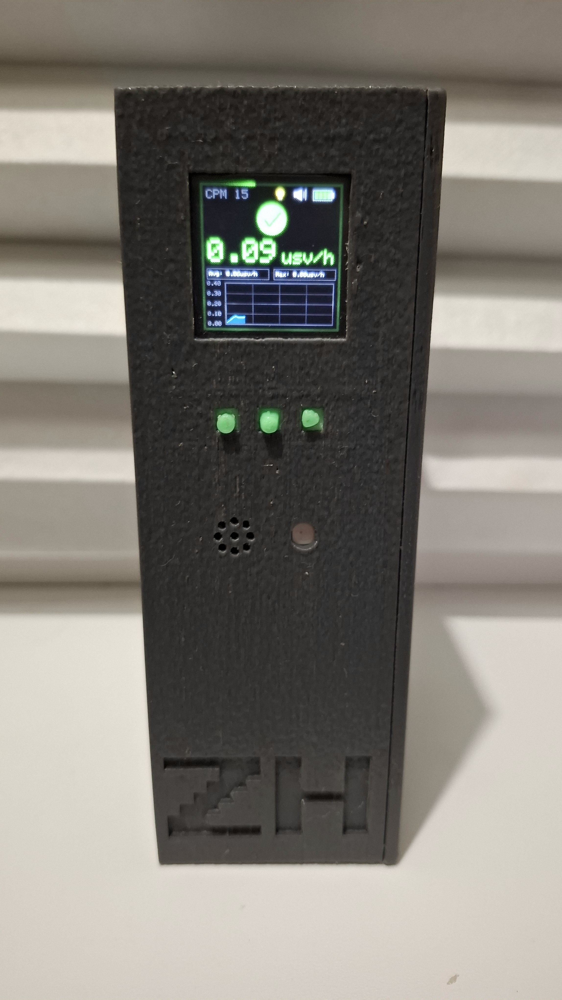
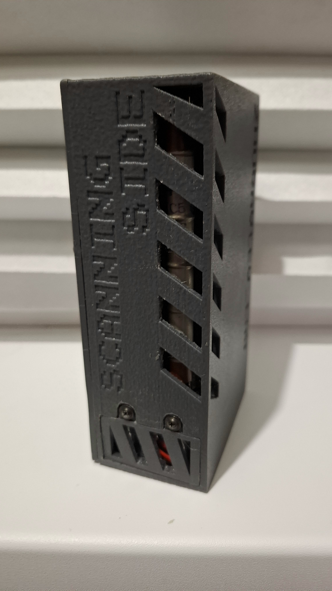
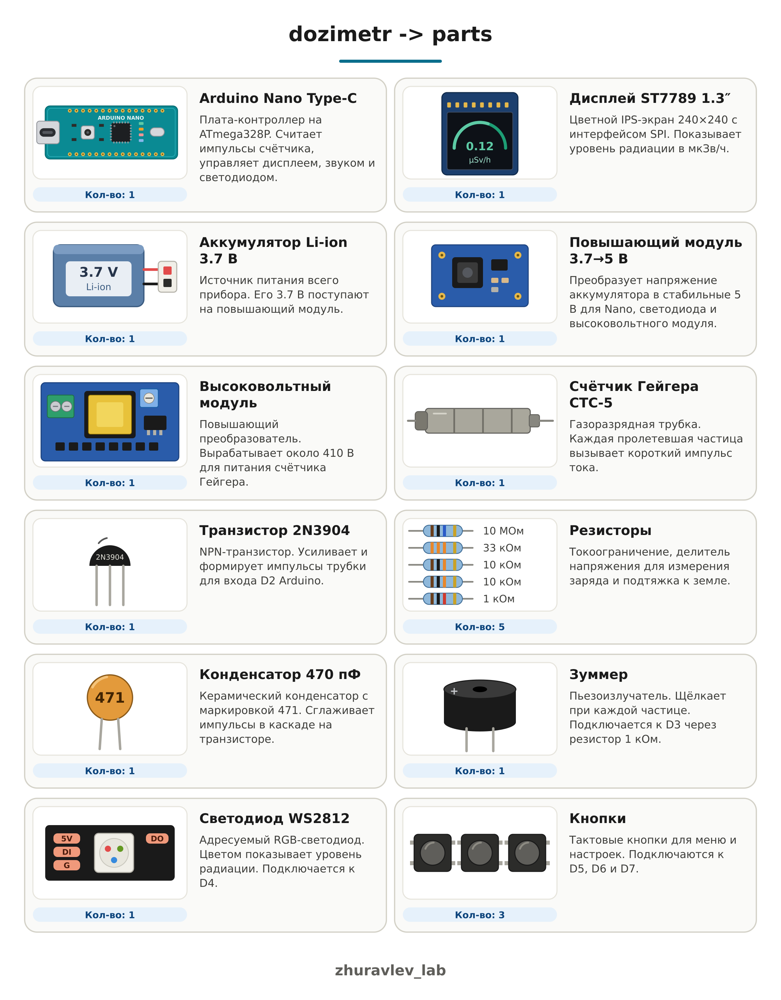
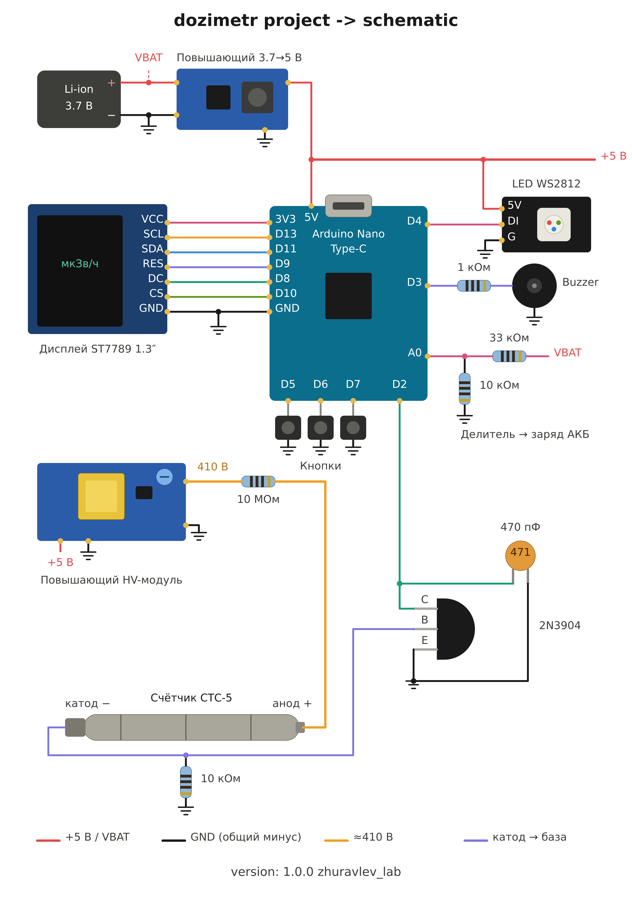
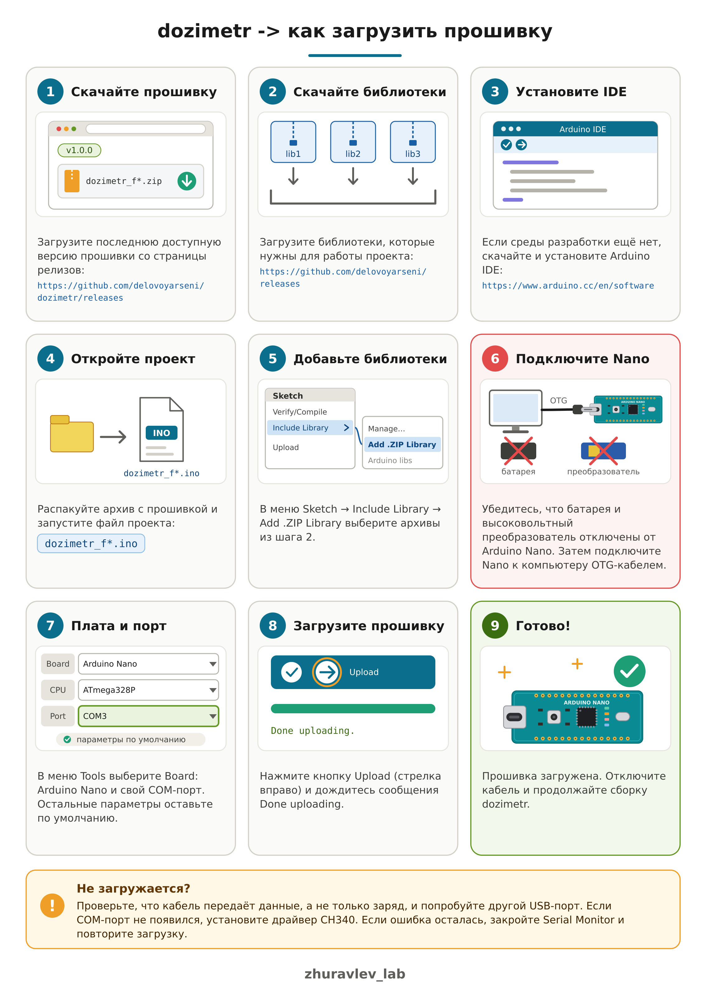

[English](README.md) | **Русский**

# ☢️ dozimetr

**Соберите свой счётчик Гейгера на Arduino Nano и трубке СТС-5**

[О проекте](#-о-проекте) · [Рендеры](#-рендеры) · [Компоненты](#-компоненты) · [Сборка](#-сборка) · [Прошивка](#-подключение-и-прошивка) · [Лицензия](#-лицензия)

---

## 📖 О проекте

**dozimetr** это радиометр с открытым исходным кодом, который можно собрать дома. Советская трубка Гейгера-Мюллера **СТС-5** регистрирует частицы, **Arduino Nano** их считает, а цветной дисплей показывает фон в **мкЗв/ч**.

Здесь опубликованы прошивка, схема подключения, список компонентов и инструкция по сборке. Соберите прибор как есть, измените его или возьмите за основу своего устройства 🛠️

**Возможности**

- 📟 Цветной IPS-дисплей (ST7789 1.3″) с текущим уровнем в мкЗв/ч
- 🔊 Щелчок зуммера на каждую частицу, как в классическом счётчике Гейгера
- 🌈 RGB-светодиод (WS2812) показывает уровень цветом
- 🎛️ Три кнопки для меню и настроек
- 🔋 Измерение заряда аккумулятора через делитель напряжения
- ⚡ Один Li-ion элемент (3.7 В): повышается до 5 В для электроники и до примерно 410 В для трубки
- 💸 Недорогие доступные детали, своя печатная плата не нужна

---

## 🖼️ Рендеры

Готовое устройство после прошивки:

  
  

---

## 🧰 Компоненты

  

| Компонент | Кол-во | Назначение |
|---|:---:|---|
| 🧠 Arduino Nano Type-C | 1 | Плата-контроллер на ATmega328P |
| 📟 Дисплей ST7789 1.3″ | 1 | Цветной IPS-экран 240×240, SPI |
| 🔋 Li-ion аккумулятор 3.7 В | 1 | Источник питания |
| ⬆️ Повышающий модуль 3.7→5 В | 1 | Стабильные 5 В для электроники |
| ⚡ Высоковольтный модуль | 1 | Около 410 В для трубки |
| ☢️ Счётчик Гейгера СТС-5 | 1 | Датчик излучения |
| 🔌 Транзистор 2N3904 | 1 | Формирует импульсы трубки |
| 🟦 Резисторы: 10 МОм, 33 кОм, 1 кОм, 2 × 10 кОм | 5 | Ограничение тока, делитель, подтяжка |
| 🟠 Конденсатор 470 пФ (маркировка 471) | 1 | Сглаживает импульсы в каскаде на транзисторе |
| 🔊 Зуммер | 1 | Щелчок на каждую частицу |
| 🌈 Светодиод WS2812 | 1 | Цветовая индикация |
| 🔘 Кнопки | 3 | Меню и настройки |

🧰 Ещё понадобятся паяльник, провода и USB-кабель с линиями данных (подойдёт OTG-кабель) для прошивки.

---

## 🔧 Сборка

  

**Таблица пинов**

| Пин Arduino | Подключение |
|---|---|
| `D2` | Импульсный выход каскада счётчика (коллектор 2N3904) |
| `D3` | Зуммер через резистор 1 кОм |
| `D4` | Вход данных WS2812 |
| `D5`, `D6`, `D7` | Кнопки (второй контакт на GND) |
| `A0` | Делитель батареи: 33 кОм к плюсу батареи, 10 кОм к GND |
| `D13` / `D11` | Дисплей SCL / SDA |
| `D9` / `D8` / `D10` | Дисплей RES / DC / CS |
| `3V3` | Питание дисплея VCC |
| `5V` | Питание WS2812 и высоковольтного модуля |
| `GND` | Общий минус |

Если на дисплее есть вывод подсветки (BLK), подключите его к VCC дисплея.

**Порядок сборки**

1. 🔋 **Питание.** Подключите аккумулятор к повышающему модулю и проверьте, что на выходе 5 В, прежде чем паять остальное.
2. 🧠 **Контроллер.** Подайте 5 В на пин `5V` Nano и соедините все земли.
3. 📟 **Дисплей.** Подключите ST7789 к `D8`–`D11`, `D13`, `3V3` и `GND`.
4. 🔘 **Кнопки.** Припаяйте их между `D5`, `D6`, `D7` и `GND`.
5. 🔊 **Зуммер и светодиод.** Зуммер идёт на `D3` через резистор 1 кОм, вход данных светодиода на `D4`.
6. 📉 **Делитель батареи.** Среднюю точку делителя 33 кОм / 10 кОм подключите к `A0`.
7. ⚡ **Высоковольтный каскад.** Питайте модуль от 5 В. Его выход идёт через резистор 10 МОм на анод трубки.
8. ☢️ **Каскад импульсов.** Катод трубки подключите к базе 2N3904, между базой и GND поставьте резистор 10 кОм. Конденсатор 470 пФ поставьте между коллектором и эмиттером. Коллектор идёт на `D2`, эмиттер на GND.
9. ✅ **Проверка.** Перед включением сверьте всё со схемой и проверьте отсутствие замыканий.

> ⚠️ **Безопасность.** Высоковольтный модуль даёт около **410 В**. Изолируйте эту часть, держите её подальше от остальной электроники и не касайтесь платы под питанием. Перед изменением монтажа отключайте аккумулятор.

---

## 🔌 Подключение и прошивка

  

> ⚠️ Перед подключением Arduino к компьютеру отключите от неё аккумулятор и высоковольтный преобразователь.

1. ⬇️ **Скачайте прошивку.** Последняя версия лежит в [Releases](https://github.com/delovoyarseni/dozimetr/releases), скетч также есть в папке [`firmware`](firmware).
2. 📚 **Скачайте библиотеки.** Они лежат в папке [`libraries`](libraries) и приложены к каждому релизу.
3. 🛠️ **Установите IDE.** Скачайте [Arduino IDE](https://www.arduino.cc/en/software), если её ещё нет.
4. 📂 **Откройте проект.** Распакуйте архив и откройте `dozimetr_f*.ino`.
5. ➕ **Добавьте библиотеки.** В меню *Sketch → Include Library → Add .ZIP Library* выберите архивы.
6. 🔌 **Подключите Nano.** Используйте OTG-кабель.
7. 🎯 **Выберите плату и порт.** В меню *Tools* укажите **Board: Arduino Nano** и свой **COM-порт**. Остальные параметры оставьте по умолчанию.
8. 🚀 **Загрузите.** Нажмите **Upload** и дождитесь *Done uploading*.
9. 🎉 **Готово.** Отключите кабель и продолжайте сборку.

❓ <b>Не загружается?</b>

- Используйте кабель с линиями данных, а не только для зарядки, и попробуйте другой USB-порт.
- Если COM-порт не появился, установите драйвер **CH340**.
- Закройте Serial Monitor и повторите загрузку.
- Проверьте, что аккумулятор и высоковольтный преобразователь отключены.

---

## 🤝 Участие

🐛 Сообщения об ошибках, 💡 идеи и 🔀 pull request приветствуются. Начните с [issue](https://github.com/delovoyarseni/dozimetr/issues). 🍴 Если делаете форк, укажите автора оригинала.

## ⚠️ Отказ от ответственности

Это самодельное учебное устройство, а не сертифицированное средство измерений. Не полагайтесь на него там, где от показаний зависят здоровье и безопасность. В проекте есть высоковольтная цепь, поэтому вы собираете и используете прибор на свой риск.

## 📄 Лицензия

Исходный код распространяется по [лицензии MIT](LICENSE): используйте, копируйте, изменяйте и распространяйте свободно, сохраняя уведомление об авторских правах и указывая автора. Документация и изображения доступны по CC BY 4.0. Сторонние библиотеки сохраняют свои лицензии.

---

⭐ Если проект понравился, поставьте звезду.

**delovoyarseni | zhuravlev_lab**

